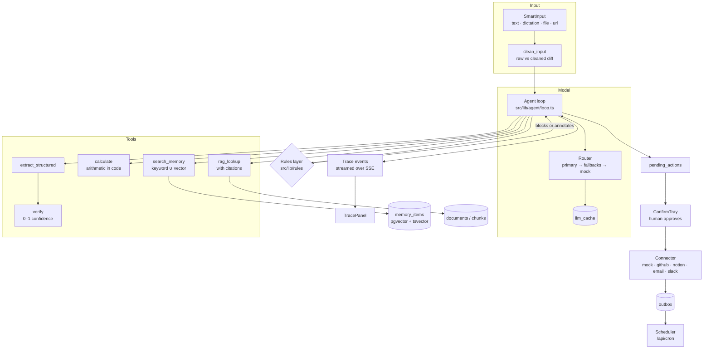

# <IDEA NAME>

> **This is the template's README skeleton.** Every `<ANGLE BRACKET>` is a placeholder.
> Run `/finalize` at the end of the day to fill it from what was actually built, or delete
> the markers and write it yourself. Judges read this first — it is worth the last hour.
>
> **What this template is:** a complete, polished UI shell with a working agentic backend
> and no domain. The UI is kept as it was built and scored; the data behind it is a demo
> seed. To adapt it per hackathon you change four things:
>
> | What | Where |
> |---|---|
> | Labels, copy, prompts, which tools are on | `idea.config.ts` |
> | The demo content every screen renders | `src/data/demo-seed.ts` |
> | New capabilities | `src/lib/tools/` (+ `/add-tool`) |
> | The submission docs | `README.md`, `MUST_BUILDS.md`, `DEMO_SCRIPT.md`, `LINKEDIN.md` |
>
> Nothing else should need editing. If you find yourself changing the agent loop, the rules
> layer or the schema, check whether a tool would do instead.

<ONE SENTENCE: what it does, for whom.>

**Live:** <https://your-app.vercel.app> · **Video:** <3-minute demo link>

---

## The problem

<One paragraph. Who has this problem, what it costs them today, and why the current
answer is inadequate. Concrete beats sweeping: one named situation lands harder than an
industry statistic.>

## Who it is for

<A specific person, not a segment. "A solo founder reconciling three bank accounts the
night before a board meeting", not "finance teams".>

## The solution

<Two or three sentences on the approach. Then say plainly what the agent decides versus
what the code computes — that distinction is the whole design and judges notice when it
is articulated.>

## The wow moment

<The one thing a judge will remember. Name the timestamp in the video where it happens.>

---

## Architecture



<Regenerate this from the modules that actually exist — `/finalize` does it. Delete the
branches this idea does not use rather than leaving them in as decoration.>

## Must-builds

See [`MUST_BUILDS.md`](MUST_BUILDS.md) for the full table with demo timestamps.

| # | Must-build | Where in code | Status |
|---|---|---|---|
| 1 | <from the brief> | `<file>` | <done / partial / todo> |

## Measured accuracy

```
<paste the output of `npm run eval` here>
```

<State the mode. A number measured in mock mode tests the plumbing, not the model — say
so if that is what it is. An honest "7/10 in live mode" beats an unqualified 100%.>

## Partner tool

**<Tool name>** — <input / build / integration / api>

<What it was used for, concretely. Screenshots in [`docs/partner-proof/`](docs/partner-proof/).>

---

## How to run

```bash
npm install
npm run dev
```

That is it. With no `.env.local` the app runs on an embedded Postgres (PGlite, with
pgvector) that migrates itself on first connect, and mock model providers. Open
<http://localhost:3000>, press **Load demo**, and ask a sample question.

To use real services, copy `.env.example` to `.env.local` and fill in what you need —
every key is optional and documented there. Check what is live at `/preflight`.

```bash
npm run demo-check   # preflight + evals + browser smoke test
npm test             # unit tests, no keys required
```

## Deploy

```bash
vercel                      # or push to a repo Vercel is watching
```

Set `DATABASE_URL` (Neon) and `CRON_SECRET` in the Vercel project — the embedded database
is per-process and will not work on serverless. `vercel.json` already registers the hourly
cron for `/api/cron`. Full checklist in [`SETUP.md`](SETUP.md).

---

## What I built vs what AI generated

<Be specific and honest. Judges have read a lot of these and the vague ones stand out.>

**My decisions:** <the idea, the problem framing, the track choice, the data model
trade-offs, what to cut when time ran short.>

**AI-generated, reviewed by me:** <which modules, and what you changed after reading
them.>

**AI-generated, used as-is:** <say so where it is true.>

Timestamped record in [`BUILD_LOG.md`](BUILD_LOG.md).

## Limits

<What it does not do, and what would break at scale. Naming your own limits is the
cheapest credibility available — and it pre-empts the question a judge was going to ask
anyway.>

- <limit>
- <limit>

## Licence

MIT — see [`LICENSE`](LICENSE).
